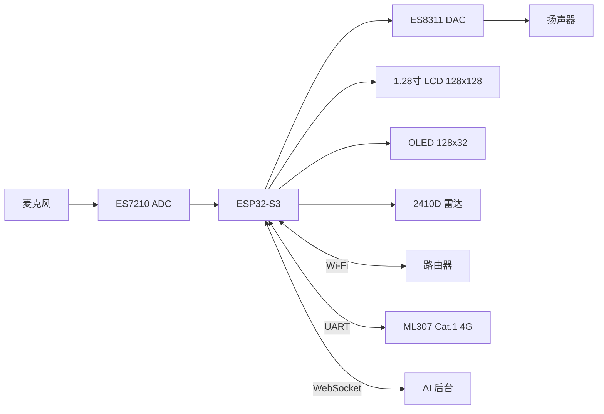

# 硬件说明

本文面向拿到「绿板小新 / 新思版」硬件、想基于本仓库二次开发的开发者。

## 0. 系统框图

## 1. 硬件概况

| 项目 | 参数 |
| --- | --- |
| 主控 | ESP32-S3（双核 240 MHz，Xtensa LX7） |
| Flash | 16 MB |
| PSRAM | 8 MB（Octal） |
| 无线 | Wi-Fi 2.4 GHz + 板载 ML307 Cat.1 4G 模组（双网络可切换） |
| 供电 | USB / 电池（电池检测为预留接口） |

## 2. 外设清单

| 外设 | 型号 / 说明 | 接口 | 引脚 |
| --- | --- | --- | --- |
| 主显示屏 | NV3023，128×128，RGB565 | SPI3 | CS=GPIO21，DC=GPIO39，MOSI=GPIO40，SCLK=GPIO41 |
| 副显示屏 | SSD1306 OLED，128×32，单色 | I2C（地址 0x3C） | SDA=GPIO1，SCL=GPIO2 |
| 背光 | PWM 调光（低电平有效） | LEDC | GPIO42 |
| 扬声器功放 | ES8311（DAC） | I2S | MCLK=GPIO38，WS=GPIO13，BCLK=GPIO14，DOUT=GPIO45 |
| 功放使能 | PA 控制脚 | GPIO | GPIO47 |
| 麦克风 | ES7210（ADC，双通道，其中一路为 AEC 回采参考） | I2S | MCLK=GPIO38，WS=GPIO13，BCLK=GPIO14，DIN=GPIO12 |
| 音频编解码 I2C | ES8311 / ES7210 控制口 | I2C | SDA=GPIO1，SCL=GPIO2 |
| 毫米波雷达 | 海凌科 2410D，人体存在 / 距离检测 | UART2 | TX=GPIO15，RX=GPIO16，115200 8N1 |
| 4G 模组 | ML307 Cat.1 | UART | 模组 TX→GPIO17，模组 RX→GPIO18 |
| 按键 1 | BOOT 键，同时作为「音量+」；长按进入工厂测试模式 | GPIO | GPIO0 |
| 按键 2 | 「音量−」；长按进入配网 / 切换 Wi-Fi 与 4G | GPIO | GPIO46 |
| 状态灯 | 板载指示灯（预留接口） | GPIO | GPIO48 |
| 摄像头 | 引脚已定义（预留接口） | DVP | XCLK=5，PCLK=7，VSYNC=3，HREF=46，D0~D7=16/18/8/17/15/6/4/9 |
| 触摸屏 | FT5x06 驱动代码已集成（预留接口） | I2C | 复用 GPIO1/GPIO2 |

> 摄像头与触摸为预留接口，当前版本以语音交互为主；需要时可在代码中打开对应初始化。电池电量检测同为预留接口。

## 3. 存储分区

分区表使用 `partitions/v1/16m.csv`：

| 分区 | 偏移 | 大小 | 用途 |
| --- | --- | --- | --- |
| `nvs` | 0x9000 | 16 KB | 配网信息、OTA 地址、WebSocket 地址、音量等 |
| `otadata` | 0xD000 | 8 KB | OTA 启动标志 |
| `phy_init` | 0xF000 | 4 KB | 射频校准 |
| `model` | 0x10000 | 960 KB | 唤醒词 / 降噪模型 |
| `ota_0` | 0x100000 | 6 MB | 应用分区 A |
| `ota_1` | 0x700000 | 6 MB | 应用分区 B |

OTA 升级时新固件写入「非当前运行」的分区，重启后由 `otadata` 决定从哪个分区启动。

## 4. 代码位置

| 内容 | 文件 |
| --- | --- |
| 引脚定义 | `main/boards/meijing-xinsi/config.h` |
| 板级初始化 | `main/boards/meijing-xinsi/meijing_xinsi_board.cc` |
| 电源管理 | `main/boards/meijing-xinsi/power_manager.h` |
| 显示 | `main/display/` |
| 雷达 | `main/radar/` |
| 音频 | `main/audio_codecs/` |
